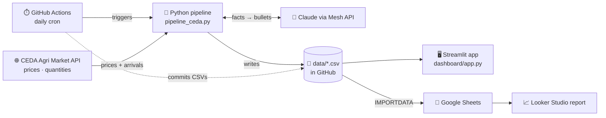

<div align="center">

#  Automated Fresh Produce Price Tracker & Market Dashboard

**An end-to-end, automated data pipeline that collects wholesale fruit prices and market arrivals from India's mandis, derives price/supply signals, writes AI-generated executive briefs with Claude, and presents everything in interactive dashboards.**


[Architecture](#-architecture) · [Features](#-key-features) · [Setup](#-setup--installation) · [Dashboard](#-dashboards) · [STAR summary](#-star-summary) · [Troubleshooting](#-troubleshooting)

</div>

---

## 📖 Table of Contents
1. [Overview](#-overview)
2. [Key Features](#-key-features)
3. [Architecture](#-architecture)
4. [Tech Stack](#-tech-stack)
5. [Project Structure](#-project-structure)
6. [Data Source & Important Notes](#-data-source--important-notes)
7. [Data Schema](#-data-schema)
8. [Analytics Logic](#-analytics-logic)
9. [AI Summary Design](#-ai-summary-design)
10. [Setup & Installation](#-setup--installation)
11. [Configuration Reference](#-configuration-reference)
12. [Dashboards](#-dashboards)
13. [Automation (GitHub Actions)](#-automation-github-actions)
14. [Troubleshooting](#-troubleshooting)
15. [Limitations](#-limitations)
16. [STAR Summary](#-star-summary)
17. [Future Improvements](#-future-improvements)
18. [Credits & License](#-credits--license)

---

## 🎯 Overview

Wholesale fruit prices in India move daily with supply, season and weather, but the raw mandi data is fragmented across thousands of markets and is hard to read at a glance. This project turns it into a clear, automated market view.

The pipeline:

1. **Collects** wholesale prices and market arrival quantities for 12 fruits across selected states from the **CEDA Agri Market API** (Ashoka University, built on Agmarknet).
2. **Cleans and stores** the data incrementally as versioned CSVs, with deduplication and resumable loads.
3. **Derives indicators**: a price index, an arrivals-based supply index, and rule-based *shortage risk*, *price spike* and *glut* signals.
4. **Generates an AI brief**: computed facts are sent to Claude (through the Mesh API), which writes 4-6 concise executive bullets.
5. **Presents insights** in a Streamlit web app and a Google Looker Studio report, refreshed by a scheduled GitHub Actions workflow.

> ⚠️ **Data freshness:** CEDA publishes with a long delay (the latest data available during development ended on **2025-10-30**). The dashboards always show a clear **"data as of"** date, and the project is best understood as a tracker of the *latest published* market period. See [Data Source & Important Notes](#-data-source--important-notes).

---

## ✨ Key Features

| | Feature | Details |
|---|---|---|
| 🔌 | **Public API ingestion** | Pulls prices and arrivals for 12 fruits, state by state, from the CEDA Agri Market API |
| 🛡️ | **Resilient by design** | Handles HTTP 429 limits, retries with backoff, stops cleanly and resumes per fruit/state, with a per-run call budget |
| ♻️ | **Incremental & idempotent** | Hashed record IDs prevent duplicates; per-series restart points prevent gaps |
| 📊 | **Supply/price signals** | Trailing-average price index, arrivals-based supply index, shortage/spike/glut flags |
| 🤖 | **AI executive brief** | Claude summarises computed facts into short bullets, with a rule-based fallback if the LLM call fails |
| 🖥️ | **Two front ends** | A Streamlit web app (Plotly) and a Google Looker Studio report |
| ⏱️ | **Automated** | GitHub Actions runs daily and commits refreshed CSVs |
| 💸 | **Free to run** | No Google Cloud project needed: CSVs in GitHub, a Google Sheet via `IMPORTDATA`, and free hosting options |

---

## 🏗️ Architecture

<div align="center">
  
</div>

<details>
<summary><b>Same diagram as Mermaid (renders natively on GitHub)</b></summary>



</details>

### How it works, step by step

| Step | Component | What happens |
|---|---|---|
| 1 | **Trigger** | GitHub Actions starts the job daily (or manually) |
| 2 | **Catalog** | `/commodities` and `/geographies` are fetched once and cached in `data/cache/` |
| 3 | **Ingest** | For each fruit × state, prices and arrivals are requested; progress is saved after every series |
| 4 | **Clean** | Dates normalised, non-positive prices dropped, hashed `record_id` added, duplicates skipped |
| 5 | **Analyse** | Rolling baselines, price/supply indices and signals are computed; an "All selected states" series is added |
| 6 | **Summarise** | Latest computed facts go to Claude, which returns 4-6 bullets (fallback: rule-based text) |
| 7 | **Publish** | CSVs are committed to the repo; Streamlit reads them directly and Looker Studio reads them through a Google Sheet |

---

## 🧰 Tech Stack

| Layer | Tools |
|---|---|
| Language | Python 3.11 |
| Data processing | pandas, NumPy |
| Data source | CEDA Agri Market API (REST, Bearer-token auth) |
| AI | Claude through the Mesh API (OpenAI-compatible, `openai` SDK) |
| Storage | CSV files versioned in GitHub (optional Google Sheets backend via `gspread`) |
| Dashboards | Streamlit + Plotly; Google Looker Studio |
| Automation | GitHub Actions (cron + manual dispatch) |

---

## 📂 Project Structure

```
fruits_analysis/
├── pipeline_ceda.py            # ingestion, cleaning, analytics, AI summary
├── requirements.txt            # pipeline dependencies
├── dashboard/
│   ├── app.py                  # Streamlit web dashboard
│   └── requirements.txt        # dashboard dependencies
├── data/                       # generated outputs (committed by the workflow)
│   ├── raw_prices.csv          # one row per date × state × fruit
│   ├── daily_summary.csv       # indices, signals, "All selected states" series
│   ├── ai_latest.csv           # newest AI brief (one bullet per row)
│   ├── ai_history.csv          # log of every brief
│   ├── state.json              # which series were checked and when
│   └── cache/                  # cached commodities.json, geographies.json
├── docs/
│   └── architecture.svg        # architecture diagram
├── .github/workflows/
│   ├── daily.yml               # daily CSV pipeline (default)
│   └── daily_sheets.yml.disabled   # alternative: Google Sheets backend
└── .gitignore
```

---

## 🌾 Data Source & Important Notes

**Source:** [CEDA Agri Market Data](https://agmarknet.ceda.ashoka.edu.in), Centre for Economic Data and Analysis, Ashoka University. It repackages the Government of India's Agmarknet mandi data. API access requires a free key from the CEDA data portal API page (email + one-time code).

**Fruits tracked:** Apple, Banana, Mango, Orange, Grapes, Papaya, Pomegranate, Pineapple, Guava, Water Melon, Lemon, Mousambi (Sweet Lime).

**Geography:** the API needs a state ID on every price/quantity request, so the pipeline queries state by state (default: Madhya Pradesh, Maharashtra, Karnataka, Tamil Nadu, Uttar Pradesh, Gujarat) and builds an **"All selected states"** series itself (average price, summed arrivals).

> ⚠️ **Publication lag.** During development, the newest published data ended on **2025-10-30** while the current date was in late October 2026. The tracker therefore shows the *most recent published period*, not live prices. Every dashboard shows the "data as of" date and warns when data is more than 60 days old.

> ⚠️ **Terms.** CEDA data is provided for non-commercial use. Please credit CEDA, Ashoka University and Agmarknet, and review their terms before redistributing the data.

> ⚠️ **Rate limits.** The API enforces strict request limits (HTTP 429). The pipeline paces its calls, stops cleanly when limited, and resumes on the next run.

---

## 🗄️ Data Schema

<details>
<summary><b>raw_prices.csv</b> (one row per date × geography × fruit)</summary>

| Column | Description |
|---|---|
| `record_id` | Hashed unique key (`id_` + 16 hex chars) used for deduplication |
| `date` | Trading date (`YYYY-MM-DD`) |
| `geography` | State name |
| `commodity` | Fruit name |
| `min_price`, `max_price`, `modal_price` | Wholesale price in INR per quintal (100 kg) |
| `arrival_qty` | Market arrivals as reported by CEDA |

</details>

<details>
<summary><b>daily_summary.csv</b> (analytics table used by both dashboards)</summary>

| Column | Description |
|---|---|
| `date`, `geography`, `commodity` | Keys (geography includes `All selected states`) |
| `modal_price`, `min_price`, `max_price`, `price_spread` | Price level and daily range |
| `arrival_qty` | Arrivals |
| `pct_change_prev` | % change in modal price versus the previous observation |
| `price_ma7`, `arrivals_ma7` | Trailing 7-observation averages (excluding the current row) |
| `price_index` | `modal_price / price_ma7` (above 1 means pricier than usual) |
| `supply_index` | `arrival_qty / arrivals_ma7` (below 1 means tighter supply) |
| `signal` | `Shortage risk`, `Price spike`, `Glut / price drop` or `Normal` |

</details>

<details>
<summary><b>ai_latest.csv / ai_history.csv</b></summary>

| Column | Description |
|---|---|
| `data_as_of` | Date of the data the brief describes |
| `rank` | Bullet order |
| `bullet` | One summary bullet |
| `model` | Model name, or `rule-based` when the fallback was used |
| `generated_at` | UTC timestamp |

</details>

---

## 🧮 Analytics Logic

Baselines use the **trailing 7 observations, excluding the current one**, and need at least 3 observations.

| Signal | Rule |
|---|---|
| 🔴 **Shortage risk** | `price_index > 1.10` **and** `supply_index < 0.85` |
| 🟠 **Price spike** | `price_index > 1.15` |
| 🔵 **Glut / price drop** | `price_index < 0.90` **and** `supply_index > 1.15` |
| 🟢 **Normal** | none of the above |

> These are transparent, tunable heuristics, not a forecasting model or financial advice. Thresholds live in `build_daily_summary()` in `pipeline_ceda.py`.

---

## 🤖 AI Summary Design

- **Only computed facts are sent to the model.** The payload contains the top risers and fallers, flagged commodities, and indices for the latest date. The model never sees raw rows, so it can't invent figures.
- **A strict system prompt** requires 4-6 bullets under 30 words each, covering spikes, drops, likely shortages and one recommended action, and tells the model to say "data as of <date>" instead of "today" because of the publication lag.
- **Gateway:** the [Mesh API](https://meshapi.ai) is OpenAI-compatible, so the standard `openai` SDK is used with a custom `base_url`. The model is configurable via `MESH_MODEL`.
- **Graceful fallback:** if the key is missing or the call fails, a rule-based summary is written instead, so the pipeline never breaks.

---

## 🚀 Setup & Installation

### Prerequisites
- Python 3.11+
- A free **CEDA API key**: register at `api.ceda.ashoka.edu.in`
- A **Mesh API key** (optional; without it the rule-based summary is used)
- A GitHub account (for automation) and a Google account (only for Looker Studio)

### 1. Clone and install
```bash
git clone https://github.com/PiyushVIT346/fruits_analysis.git
cd fruits_analysis
python -m venv .venv
# Windows: .venv\Scripts\activate      macOS/Linux: source .venv/bin/activate
pip install -r requirements.txt
pip install -r dashboard/requirements.txt
```

### 2. Set environment variables

**Windows (cmd)**
```
set CEDA_API_KEY=your_ceda_key
set MESHAPI_API_KEY=your_mesh_key
```
**macOS / Linux**
```bash
export CEDA_API_KEY=your_ceda_key
export MESHAPI_API_KEY=your_mesh_key
```

### 3. Probe the API (recommended first step)
```bash
python pipeline_ceda.py --probe
```
This loads the catalog, detects the request format, and shows which periods contain data. It uses only a handful of calls.

### 4. Run a small first load
```bash
# Windows: set STATES=Madhya Pradesh,Maharashtra     macOS/Linux: export STATES="Madhya Pradesh,Maharashtra"
python pipeline_ceda.py
```
- Outputs appear in `data/`.
- If the API rate-limits you, the run stops cleanly. **Wait 15-30 minutes and run the same command again**; it resumes where it stopped.
- Add more states once this works.

### 5. Launch the web dashboard
```bash
streamlit run dashboard/app.py
```
Open `http://localhost:8501`.

### 6. Automate with GitHub Actions
1. Push the project to a **public** GitHub repository.
2. Go to **Settings → Secrets and variables → Actions → Repository secrets** and add:
   - `CEDA_API_KEY`
   - `MESHAPI_API_KEY`
3. Under **Settings → Actions → General → Workflow permissions**, choose **Read and write permissions**.
4. Open the **Actions** tab, run **daily-produce-pipeline-ceda** once manually, and confirm it commits updated files in `data/`.

### 7. Build the Looker Studio report (optional)
1. Create a Google Sheet with tabs `daily_summary`, `ai_latest` and `raw_prices`.
2. In cell **A1** of each tab, use the **raw** GitHub URL (not the `/blob/` page):
   ```
   =IMPORTDATA("https://raw.githubusercontent.com/<USER>/<REPO>/main/data/daily_summary.csv")
   ```
3. Format the date columns as **Date** (Sheets stores them as serial numbers such as `45658`).
4. In [Looker Studio](https://lookerstudio.google.com): **Create → Report → Google Sheets**, add each tab as a data source, and set `date` to type **Date**.
5. Suggested charts: price time series by fruit, arrivals (bars) vs price (line), a signals table with conditional formatting, and an `ai_latest` table for the AI brief.

### 8. Deploy the Streamlit app for free (optional)
Create an app at [share.streamlit.io](https://share.streamlit.io) pointing at `dashboard/app.py`. It reads `data/` from the repo, so each daily commit refreshes the app. To read from GitHub instead, set `DATA_URL_BASE` to `https://raw.githubusercontent.com/<USER>/<REPO>/main/data`.

---

## ⚙️ Configuration Reference

| Variable | Default | Purpose |
|---|---|---|
| `CEDA_API_KEY` | *(required)* | CEDA API bearer token |
| `MESHAPI_API_KEY` | *(optional)* | Enables Claude summaries |
| `MESH_MODEL` | `anthropic/claude-sonnet-4.5` | Model name on the Mesh gateway |
| `MESH_BASE_URL` | `https://api.meshapi.ai/v1` | OpenAI-compatible endpoint |
| `STATES` | six large states | Comma-separated states to track |
| `FIRST_START` | `2025-01-01` | Start date for the first load |
| `MAX_CALLS` | `120` | API calls allowed per run |
| `CEDA_RATE_SLEEP` | `6` | Seconds between API calls |
| `CEDA_CHUNK_DAYS` | `366` | Date window per request |
| `SKIP_IF_CHECKED_DAYS` | `3` | Skip series checked within this many days |
| `CEDA_EXTRA_BODY` | `{}` | Extra JSON fields for requests, if the API requires any |
| `DATA_DIR` | `data` | Output folder |
| `BACKEND` | `csv` | `csv` or `sheets` (Sheets needs `GSHEET_ID` and Google credentials) |

**CLI flags**

| Flag | Purpose |
|---|---|
| `--probe` | Inspect API responses and find periods with data |
| `--since YYYY-MM-DD` / `--until YYYY-MM-DD` | Re-fetch a specific range |
| `--force` | Ignore the "recently checked" skip list |
| `--backend csv\|sheets` | Choose the storage backend |

---

## 📸 Dashboards

> Add your screenshots to `docs/screenshots/` and they will appear here.

| Streamlit app | Looker Studio report |
|---|---|
|  |  |

**Streamlit tabs:** 📈 Price trends · ⚖️ Supply vs price · 🚦 Signals · 🗺️ State comparison · 📄 Data (with CSV download). The top of the page always shows the data freshness banner, KPIs and the 🤖 AI market brief, with earlier briefs in an expander.

---

## ⏱️ Automation (GitHub Actions)

The workflow in `.github/workflows/daily.yml`:
- runs **daily at 12:30 UTC (18:00 IST)** and on manual trigger,
- installs dependencies, runs `pipeline_ceda.py` with `BACKEND=csv`,
- commits changed files in `data/` back to the repository.

Because each run is limited by `MAX_CALLS` and skips recently checked series, a large initial load simply completes over several runs. When CEDA has nothing new, runs finish quickly with no commit.

---

## 🩺 Troubleshooting

| Symptom | Cause and fix |
|---|---|
| `Cannot GET /v1/agmarknet/prices` | The route is POST-only; the script falls back to POST automatically. Use the latest `pipeline_ceda.py` |
| `400: Commodity id, state id, start and end date are required` | A state ID is mandatory; make sure `STATES` resolves (run `--probe`) |
| `HTTP 429 Too many requests` | Rate-limited. Wait 15-30 min, set `CEDA_RATE_SLEEP=10` and/or lower `MAX_CALLS`, then rerun; it resumes |
| `No data exists` for a fruit/state | Normal; that pair has no published data and is skipped |
| Google Sheet shows HTML code | You used a `github.com/.../blob/...` link. Use `raw.githubusercontent.com/...` |
| Dates appear as `45658` | Format the column as **Date** in Sheets and set the field type to **Date** in Looker Studio |
| Looker shows blank charts | Confirm the `IMPORTDATA` cells loaded, then **Reconnect** the data source |
| AI summary says `rule-based` | `MESHAPI_API_KEY` is missing/invalid or the call failed; check the console message |
| Workflow can't push | Enable **Read and write permissions** under Settings → Actions → General |
| Dashboard says no data found | Run the pipeline first, or set `DATA_DIR` / `DATA_URL_BASE` |

---

## 🚧 Limitations

- **Data lag:** the source publishes roughly a year behind, so this is not a live price feed.
- **State-level granularity:** the API requires a state, so market-by-market detail is not included.
- **Supply is a proxy:** it is based on reported arrivals, and "demand" is inferred from price movement; no true demand data exists in the source.
- **Heuristic signals:** thresholds are rules of thumb, not a statistical or forecasting model.
- **Rate limits:** large backfills take several runs.
- **Non-commercial data terms** apply to the CEDA data.

---

## ⭐ STAR Summary

### 🅢 Situation
Wholesale fruit prices in India swing with supply, season and weather, and traders and analysts need a quick read on which fruits are getting expensive or scarce. The public mandi data that exists is fragmented across thousands of markets, awkward to query, and offered only as raw records, so spotting trends or shortages means a lot of manual work. The data source also turned out to be rate-limited and to publish with a long delay.

### 🅣 Task
Build an automated, end-to-end solution using **only publicly available data** that:
- ingests daily-granularity wholesale fruit prices and market arrivals through an API,
- processes and stores them reliably and incrementally,
- uses an LLM (Claude via the Mesh API) to write concise executive-level summaries of price movements and possible shortages,
- and presents interactive insights through dashboards, with automated refreshes and no paid infrastructure.

### 🅐 Action
- **Selected and integrated the data source:** found and registered for the CEDA Agri Market API, then probed it directly to learn its real behavior (POST-only routes, a required state ID, response structure and field names).
- **Engineered a resilient ingestion layer** in Python: exponential backoff, a three-strike rate-limit stop, per-series restart points, a per-run call budget, cached catalog calls, and hashed record IDs for deduplication, so interrupted runs resume without gaps or duplicates.
- **Derived analytics:** built trailing-average price and arrivals-based supply indices, an "All selected states" aggregate, and transparent shortage/spike/glut rules.
- **Designed the AI layer:** sent only computed facts to Claude through an OpenAI-compatible gateway, with a strict prompt, date-aware wording, and a rule-based fallback.
- **Built two front ends:** a Streamlit + Plotly web app (KPIs, trends, supply vs price quadrant, signals, state comparison, AI brief with history) and a Google Looker Studio report fed by a Google Sheet.
- **Automated and de-risked the setup:** replaced a Google Cloud service-account design with CSVs in GitHub plus `IMPORTDATA`, and scheduled everything with GitHub Actions.
- **Tested the logic offline** against simulated rate limits to confirm that partial runs resume correctly.

### 🅡 Result
- ✅ A working, fully automated pipeline: API → analytics → AI brief → two dashboards, refreshed daily with **no paid infrastructure and no Google Cloud project**.
- ✅ **[N]** fruit × state series and **[X]** daily records collected, covering **[date range]** *(fill in from your `data/raw_prices.csv`)*.
- ✅ Resumable, idempotent loads: reruns after rate limits add only missing data, with no duplicates.
- ✅ Automated plain-language market briefs that turn computed price and supply signals into 4-6 executive bullets, replacing manual chart reading.
- ✅ An honest "data as of" design that surfaces the source's publication lag instead of hiding it.
- 📚 **Key learnings:** probing and designing around real API constraints, building rate-limit-safe incremental ETL, grounding LLM output in computed facts, and being transparent about data limitations.

---

## 🔭 Future Improvements

- [ ] Add the near-live **data.gov.in (Agmarknet)** feed alongside CEDA history for current prices
- [ ] 7-day price **forecasting** per fruit
- [ ] **Alerts** (email/Slack) when a shortage signal appears
- [ ] Market-level (mandi) drill-down using CEDA's `/markets` endpoint
- [ ] Seasonality and year-over-year comparison views
- [ ] Unit tests and data-quality checks in CI

---

## 🙏 Credits & License

- **Data:** [CEDA Agri Market Data](https://agmarknet.ceda.ashoka.edu.in), Centre for Economic Data and Analysis, Ashoka University, derived from **Agmarknet**, Government of India. Used under CEDA's non-commercial terms.
- **AI:** Claude by Anthropic, accessed through the Mesh API.
- **Code license:** choose a license for the repository (MIT is a common choice) and add a `LICENSE` file.

<div align="center">

Built by **[Your Name]** · [GitHub](https://github.com/PiyushVIT346) · [LinkedIn](https://www.linkedin.com/) 

⭐ If you found this project useful, consider starring the repo.

</div>
